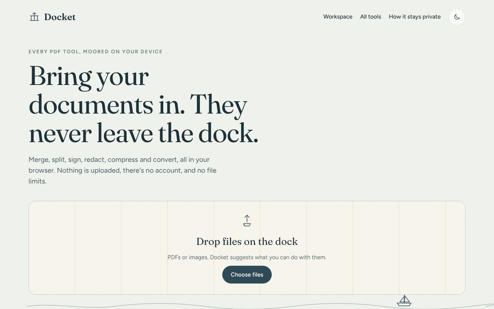

# Docket

Free PDF tools that run entirely in your browser. Merge, split, sign, redact, compress, convert and more, without uploading anything.

[Open Docket](https://lekanlawal1.github.io/docket/)



## Why I built it

Most free PDF sites upload your file to their server to do something your own computer could do in a second. That's fine for a menu. It's not fine for a lease, a bank statement or a signed contract. Docket does everything on your device, so there's nothing to upload, no account and no file-size limit beyond what your browser can handle.

## What's in it

About 40 tools across seven groups: organise, convert, edit and sign, protect, shrink and fix, read, and images. There's also a Workspace that keeps one document through many changes, with undo and redo, so you download once at the end. It works offline and can be installed as an app.

## The parts I'm most careful about

Redaction is real. A lot of tools draw a black box over the text and leave the text underneath. Docket redraws marked pages as images with the boxes burned in, then reads the result back, and if any redacted text can still be found, it doesn't save.

Passwords are checked before you get the file. The locked PDF is opened once without the password, where it must refuse, and once with it, where it must open.

Compress keeps your text sharp and selectable. It only shrinks the pictures. If the result isn't actually smaller, it tells you instead of handing you a bigger file.

PDF to Word rebuilds the document's structure. A PDF only stores where each bit of text sits, so Docket works out paragraphs, headings, lists, tables and columns from positions and fonts. You get a preview before saving.

Fill a form works on scans and photos with no form fields. It finds the blank lines and tick boxes itself, so you can type onto them, and you can add any it missed.

## Run it

There's no build step. Serve the folder with any static server, since it uses ES modules:

```sh
python3 -m http.server
npm install && npm test     # unit tests
npm run test:e2e            # drives every tool in Chromium with generated PDFs
```

After changing any file, run `npm run offline` to update the offline file list.

## More

[docs/details.md](docs/details.md) has the full list of tools, how each tricky one works, and the code layout. It's built with plain JavaScript, [pdf-lib](https://pdf-lib.js.org/), [PDF.js](https://mozilla.github.io/pdf.js/), [qpdf](https://github.com/qpdf/qpdf) and [Tesseract.js](https://github.com/naptha/tesseract.js), all kept in `vendor/` with their licences.

MIT licence. See [LICENSE](LICENSE).
